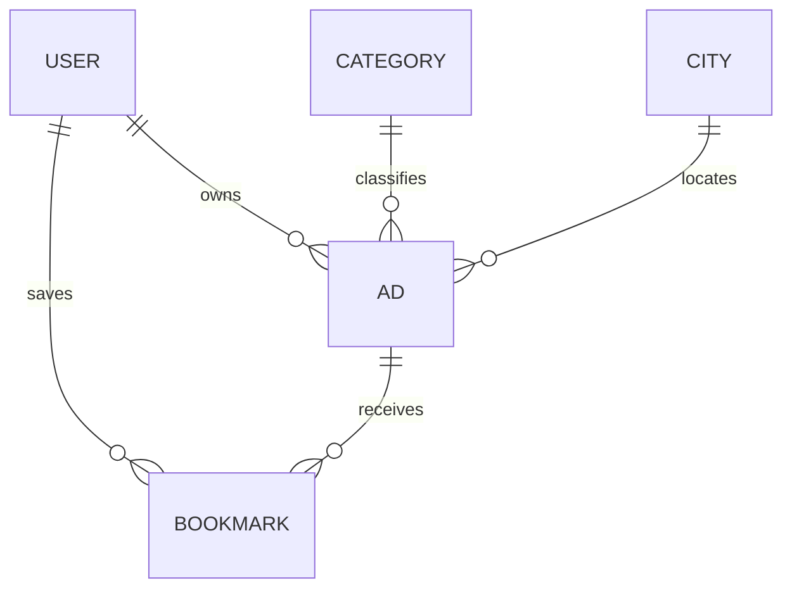
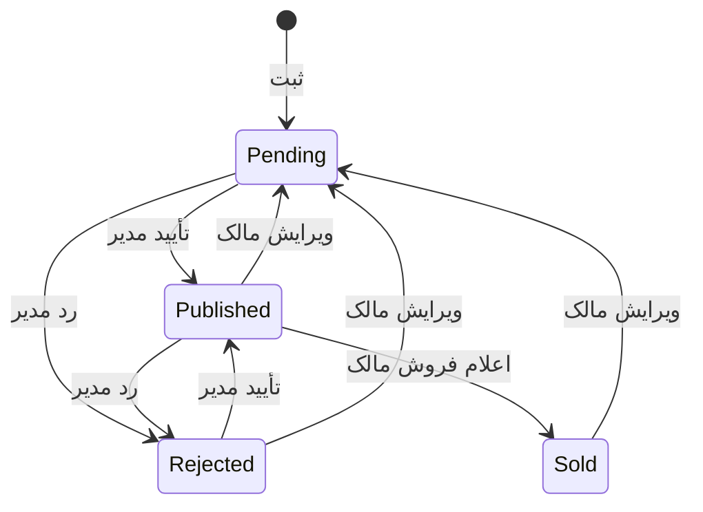

# معماری پروژه و توضیح کد

## الگوی MVT

| لایه | نمونه در پروژه | وظیفه |
| --- | --- | --- |
| Model | `Ad` در `listings/models.py` | ساختار و رابطه داده |
| View | `ad_create` در `listings/views.py` | پردازش درخواست و تصمیم‌گیری |
| Template | `templates/listings/form.html` | نمایش صفحه |
| Form | `AdForm` در `listings/forms.py` | تبدیل و اعتبارسنجی ورودی |
| URL | `listings/urls.py` | رساندن درخواست به View |

Viewهای عمومی به‌صورت تابع نوشته شده‌اند تا مسیر اجرا برای مبتدی روشن باشد. ورود و خروج از Viewهای آماده Django استفاده می‌کنند؛ بازنویسی احراز هویت، هدف این پروژه نیست.

## مدل داده



- رابطه مالک آگهی با کاربر از `settings.AUTH_USER_MODEL` استفاده می‌کند.
- حذف دسته یا شهر دارای آگهی با `PROTECT` متوقف می‌شود تا آگهی بدون رابطه باقی نماند.
- حذف کاربر، آگهی‌ها و نشان‌های او را با `CASCADE` حذف می‌کند؛ برای سیستم واقعی سیاست نگهداری اطلاعات را جداگانه تعیین کنید.
- هر جفت کاربر/آگهی فقط یک نشان دارد. این قاعده با `UniqueConstraint` در دیتابیس نیز برقرار است.
- قاعده نوع قیمت با `CheckConstraint` پشتیبانی می‌شود تا حتی تغییر مستقیم دیتابیس هم مقدار ناسازگار نسازد.
- شاخص‌های دیتابیس روی وضعیت/زمان و شهر/دسته/وضعیت به جست‌وجوی رایج کمک می‌کنند. شاخص مناسب را با رشد واقعی داده بازبینی کنید.

## مسیر ثبت آگهی

1. `login_required` از ثبت بدون ورود جلوگیری می‌کند.
2. در GET یک `AdForm` خالی نمایش داده می‌شود.
3. در POST، متن از `request.POST` و تصویر از `request.FILES` وارد فرم می‌شود.
4. `is_valid()` هم فیلدهای فرم و هم اعتبارسنجی مدل را اجرا می‌کند.
5. `save(commit=False)` یک شیء ذخیره‌نشده می‌دهد.
6. View مالک را از `request.user` و وضعیت را «در انتظار» قرار می‌دهد.
7. `save()` رکورد و تصویر را ذخیره می‌کند.
8. Redirect به «آگهی‌های من» از ثبت مجدد همان POST هنگام Refresh جلوگیری می‌کند.

نمونه کوتاه از منطق اصلی:

```python
ad = form.save(commit=False)
ad.owner = request.user
ad.status = Ad.Status.PENDING
ad.save()
```

این خطوط دلیل حذف فیلدهای `owner` و `status` از فرم عمومی هستند. اعتماد به مقدارهای ارسالی مرورگر برای این دو فیلد، کنترل دسترسی را از بین می‌برد.

## کنترل مالکیت

در ویرایش، حذف و اعلام فروش از این الگو استفاده شده است:

```python
ad = get_object_or_404(Ad, pk=pk, owner=request.user)
```

پنهان‌کردن دکمه در قالب به‌تنهایی کافی نیست. محدودیت باید هنگام دریافت شیء از دیتابیس اعمال شود. بازگرداندن 404 برای آگهی غیرمجاز، از افشای وجود آن نیز جلوگیری می‌کند.

## جست‌وجو و صفحه‌بندی

`SearchForm` به‌جای استفاده مستقیم از پارامترهای URL، مقدار شهر/دسته و مبلغ را بررسی می‌کند. اگر پارامتر نامعتبر باشد، پیام خطا و نتیجه خالی برمی‌گردد. `icontains` در عنوان و توضیح یک جست‌وجوی ساده آموزشی است؛ موتور جست‌وجوی زبانی فارسی نیست.

`select_related` رابطه دسته، شهر و مالک را در کوئری اصلی دریافت می‌کند و از کوئری جدا برای هر کارت جلوگیری می‌کند. `Paginator` دوازده آگهی در هر صفحه می‌آورد. تگ داخلی `querystring`، فیلترهای فعال را هنگام تغییر صفحه حفظ می‌کند.

## ارقام و قیمت

تابع `normalize_digits` ارقام فارسی و عربی را به ارقام انگلیسی تبدیل می‌کند. `PersianIntegerField` جداکننده مبلغ را حذف می‌کند و سپس از بررسی عددی Django استفاده می‌کند. قالب با فیلتر `toman` مبلغ را با ارقام فارسی نمایش می‌دهد؛ دیتابیس همچنان عدد واقعی نگه می‌دارد.

## تصویر

فرم تصویر را با Pillow بررسی و بازکدگذاری می‌کند. نام فایل با UUID ساخته می‌شود. محل ذخیره، `MEDIA_ROOT` است؛ فایل‌هایی که بخشی از کد هستند در `STATICFILES_DIRS` قرار دارند. این دو کاربرد را با هم مخلوط نکنید.

در این نسخه، حذف آگهی یا تعویض عکس، فایل قدیمی را از دیسک پاک نمی‌کند. این رفتار پیش‌فرض Django است؛ پاک‌سازی امن فایل‌های بی‌استفاده یک تمرین مستقل است.

## وضعیت‌ها



خروج و تغییر نشان با POST انجام می‌شوند و فرم‌ها توکن CSRF دارند. توضیحات آگهی با autoescape قالب نمایش داده می‌شود؛ از `safe` برای متن کاربر استفاده نشده است.
